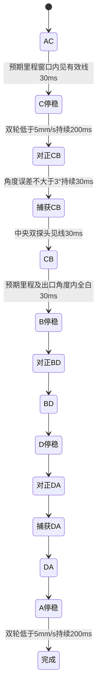

# 任务三独立模块：与 T13 模块化并行准备

2026-10-11。用户确认沿用 `car_app/car_route/car_heading/car_line` 结构。本包新增任务三路线内核和 T13 接口适配器，保存在独立目录；本次未写入 T13 准备包或实际 Sunward 工程。

当前阶段：路线代码、主机状态机测试、适配器测试、ASan/UBSan 和两个新编译单元的 Cortex-M3 编译通过。尚未完成整车接入、整车链接、烧录或任务三现场验收。本包没有可下载的任务三 HEX。

## 题目路线和几何

依据工作区 `H题_自动行驶小车.pdf` 第1页赛道图、第2页要求（3）及说明（4）。路线为 A→C 斜线、C→B 右侧半圆、B→D 斜线、D→A 左侧半圆；一圈不大于40秒。经过点、启动、停车均需声光，启动/经过/停车时车身地面投影需覆盖顶点。

题图取 AB=1000mm、半径 R=400mm，纵向间距为2R=800mm：

- 斜线 AC=BD=`hypot(1000,800)`≈1280.625mm。
- 斜线与水平切线夹角 α=`atan2(800,1000)`≈38.660°。
- 两半圆的名义弧长为 πR≈1256.637mm。
- 总路线名义长度≈5074.52mm；以200mm/s匀速约25.37秒。此估算没有计入加速、接近减速、停稳和转向，不能证明能在40秒内完成。

默认弧段门槛使用1256mm，与当前任务二参数一致，但任务二记录来自 BC 方向，不能代替任务三 CB 反向及 DA 的现场标定。默认窗口、转向/捕获距离和速度均为初版参数，需根据实际探头位置与车身尺寸验证。

初始摆车：A 点，车头朝 C。起始MPU相对角度记为 h，不要求校准后手动把角度设为零。正角为左转，现有实测记录已确认该符号。

| 路段或衔接 | 参考航向 | 控制方式 |
| --- | --- | --- |
| AC | h | 白底航向保持 |
| C 对正 CB 入口 | h+α | 左轮零、右轮前进，左转约α |
| CB | 入口 h+α；出口 h+α+180° | LF04巡线，左转半圆 |
| B 对正 BD | h+180°+2α | 左轮零、右轮前进，左转约α |
| BD | h+180°+2α | 白底航向保持 |
| D 对正 DA 入口 | h+α+180° | 左轮前进、右轮零，右转约α |
| DA | 入口 h+α+180°；出口 h+α | LF04巡线，右转半圆 |

所有角度差归一化至[-180°,180°)。巡线反馈的物理左右和黑白极性沿用 `car_line`，不能因 CB 方向改变而直接把纠偏增益反号。

## 状态与接口

`car_task3.h/.c` 不依赖 HAL，通过显式状态对象管理单圈；`car_task3_port.h/.c` 对接现有上下文和航向/巡线/声光模块。



`CarTask3 route={0};` 必须零初始化，生命周期与整车应用一致。`CarTask3_Start` 只允许 IDLE/DONE/FAULT 启动；活动期间重复启动不重置计时。Start要求使能有效、无停止/保护故障、航向就绪、采样新鲜且双轮静止。它假定上层已经验证ADC、低压、ON稳定时间等原启动门槛。

每个新的10ms有效采样调用 `CarTask3_Update` 一次。输入是新鲜的轮速、累计有符号平均里程、航向、LF04有效性/黑点数与中央两探头状态。`sample_age_ms` 必须代表最新的同步采样；适配器当前用LF04年龄，上层仍必须保留MPU/DWT节拍和I/O错误检查。

输出为 HALT、航向保持、仅前进转向、LF04巡线四种意图。`signal_point` 是单次调用事件，交给现有500ms非阻塞声光定时器。首次更新产生A启动提示，之后产生C、B、D、A四次到达提示；最终A提示在停稳确认后发出。

见到候选顶点或角度到位时先零输出，再确认稳定时间；转向限制4秒/平均里程80mm，入弧捕获限制2秒/60mm。转向和捕获里程不计入下一直线/半圆长度。半圆中途无有效线立即HALT，持续100ms锁存故障；仅预期窗口、出口航向及全白同时满足才允许正常退出。

40秒从Start计时，包括所有停稳、转向和捕获及最终停车。到达40秒仍未完成则故障停车；不会将超时写为完成。OFF、STOP、保护故障、无效/陈旧采样和节拍缺失均优先于换段与声光，故障保持到新Start。

## T13接入清单

以下是具体待合并位置。本次没有改动这些文件，便于当前模块化工作完成后再合并。

1. `car_state.h` 在Motion末尾追加 `MOVE_TASK3`，不改变原枚举值；包含 `car_task3.h`，在CarRouteState中增加 `CarTask3 task3;`。初始化时清零该字段。
2. `car_config.h` 增加独立任务三配置入口，调用 `CarTask3_DefaultConfig` 后覆盖参数。保持任务一/二和独立半圆的现有参数。入门配置 `deadline_ms=40000`。
3. `car_button.c` 增加任务三选择，使用现有OFF长按/短按校准/ON新按启动/忙状态STOP流程。实际运行仍由实体按键独立完成；串口诊断不承担运行中的人工换段。
4. `car_line.c` 在任务三被选中或运行时持续采样LF04，包含白底直线、停稳、对正与捕获。否则旧代码的模式过滤会让新任务没有新鲜LF04数据。
5. `CarRoute_Request` 原有启动门槛通过后，以同步采样构造 `CarTask3Port_Input` 并调用Start；成功才设置运行状态。路程计数以新编码器快照开始，读取的平均里程与Start基线保持一致，不可Start后又单独清零。
6. `CarRoute_Update` 保留已验证的有符号编码器换算及FAST检查，任务三分支积累两轮里程后调用内核，随后返回；不要继续执行旧任务的定距停车、减速、Task2换段或目标覆盖分支。
7. `car_app.c` 保留OFF/STOP/RX/ADC/LOW/GAP/MPU/FAST/REV/STALL优先次序，在有效10ms样本后更新任务三，最后提交轮速PI和两电机PWM。任务三对正时禁用旧“航向误差>20°立即YAW”业务检查，由内核管理对正目标；MPU读取失败、饱和、节拍异常仍无条件停车。白底对正/捕获不能被旧 `UsesLine && !line.valid` 全局门槛阻止；ARC阶段有效线门槛继续保留。
8. 内核所有停稳阶段保持上层RUNNING并输出HALT；不要在每次顶点停稳时调用旧BRAKING分支，否则旧逻辑会结束整次任务。T3_FAULT调用统一停车，已有具体保护停车原因应保留；T3_DONE在应用层停机，完成声光交由该次输出事件处理一次，避免旧DONE声光重复。
9. `CarTask3Port_Apply` 只设置目标和声光/零输出；它不提交正PWM。每次Apply后仍检查应用状态、物理使能与双轮保护，再统一提交原A=右、B=-左电机映射。调用FAULT停车后不能Apply旧运动输出。
10. `car_wheel.c` 转向零目标轮必须清除自身积分并输出零；保留这一路FAST/REV检查，零目标不累积STALL。另一轮正常执行PI及全部保护。原PI可能用残余积分把零目标轮驱动起来，不能仅写目标零就认为实现了前进式转向。
11. `car_ui.c` 增加TASK 3、AC/CB/BD/DA、phase/fault、段里程和总耗时显示。转向时显示目标/当前航向有助于查衔接；保持既有OLED长度限制和非阻塞诊断。
12. 加入两个新`.c`，保留单独编译。使用 `hypotf/atan2f/fmodf/fminf/fmaxf`，最终链接需包含现有数学库 `-lm`。

目标为零轮的处理应放在原FAST/REV判定后、PI更新前，例如：

```c
if (app->route.motion == MOVE_TASK3 && app->route.targets[i] == 0.0f) {
    w->integral = 0.0f;
    w->command = 0;
    w->stall_us = 0U;
    return; /* FAST/REV已在此前执行。 */
}
```

整车接入后再跑原任务一/二回归和任务三调度测试，验证旧条件不会抢停/覆盖任务三输出，零目标轮无正驱动力、两轮均不后退、保护优先及声光次数。当前适配器测试使用模拟模块，只证明数据映射和目标生成，不证明整车调度已接通。

## 已执行验证与现场边界

运行 `python3 tools/run_tests.py`，默认读取同级T13模块头文件；可用 `--module-root` 指向其他重构工程。主机测试结果在 `verification/host_tests.txt`，ARM编译命令及返回值在 `verification/arm_compile.json`。

测试覆盖：几何与相对航向、AC/CB/BD/DA完整状态顺序、左右前进式转向、起始A和四个到达事件、最终停稳、重新启动、角度及millis回绕、早见线拒绝、连续消抖、错误出口航向、中途丢线即停及锁存、OFF/STOP/外部保护、采样/节拍/数值错误、距离/转向/捕获/停稳界限、40秒截止。ASan/UBSan通过；两个新C文件用实际STM32F103编译参数加 `-Wall -Wextra -Werror` 编译成功。

实测记录截至2.59仍是任务二出口修正后的衔接待验证。任务三本包是软件准备。前进式单轮转向会产生位置偏移，捕获也会前进；车身投影是否持续覆盖顶点/弧线、双向巡线效果、每点提示位置和40秒完成均必须在真实场地确认。该算法没有从软件层面证明这些物理条件，实际偏移过大时需调整衔接轨迹、传感器位置或转向参数，不能仅放宽换段窗口。
